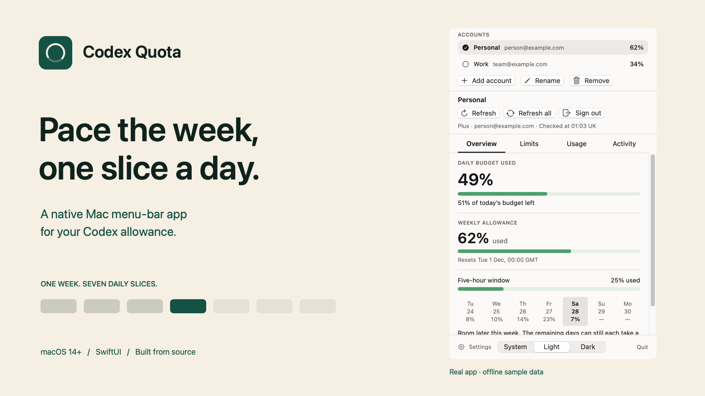
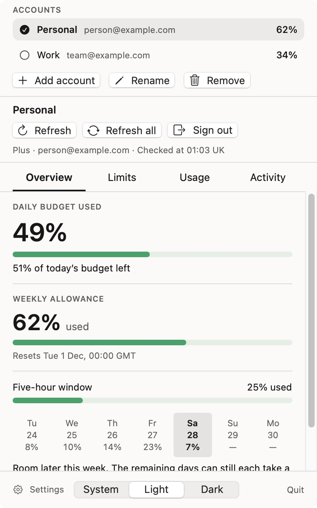
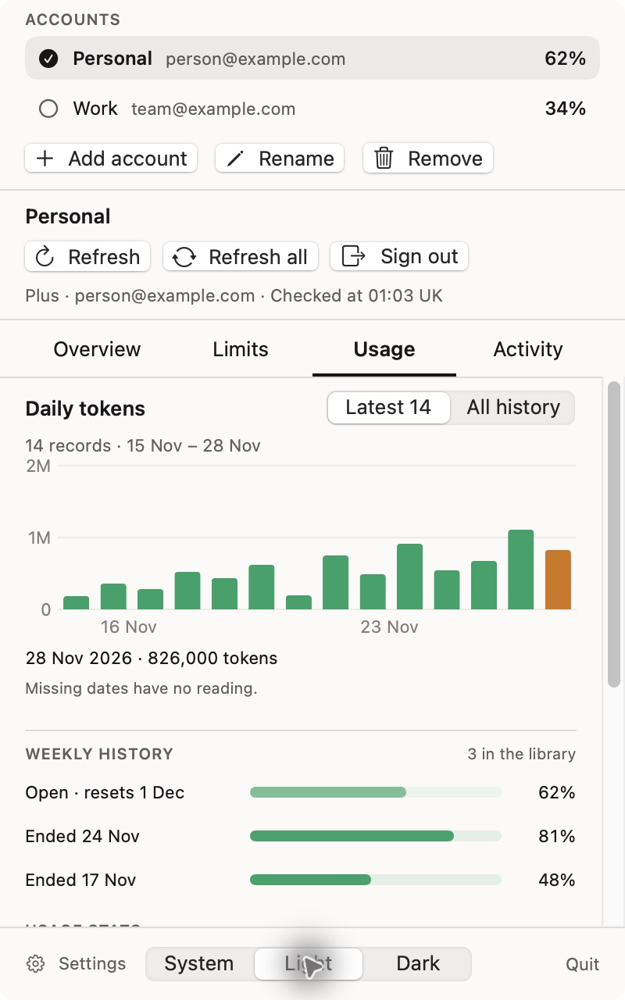
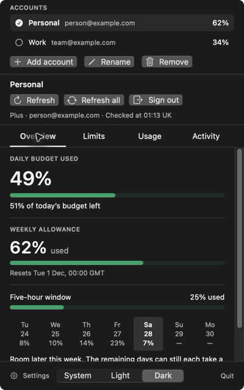
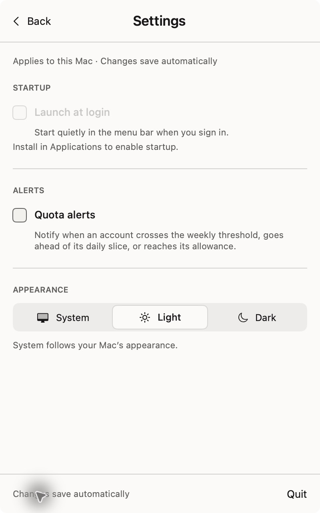

<p align="center">
  <picture>
    <source media="(prefers-color-scheme: dark)" srcset="docs/assets/branding/hero-dark.png">
    
  </picture>
</p>

<h1 align="center">A little perspective on your Codex allowance.</h1>

<p align="center">
  A native Mac menu-bar app that puts today’s usage in the context of your week.<br>
  Keep personal and work accounts together, follow the history, and leave room for the next idea.
</p>

<p align="center">
  <a href="docs/GETTING-STARTED.md"></a>
  <a href="Package.swift"></a>
  <a href="#get-started"></a>
</p>

<p align="center">
  <a href="#get-started"><strong>Get started</strong></a> &nbsp;·&nbsp;
  <a href="#see-it-in-action">Take the tour</a> &nbsp;·&nbsp;
  <a href="docs/FEATURES.md">Explore the features</a> &nbsp;·&nbsp;
  <a href="docs/GETTING-STARTED.md">Build and run</a>
</p>

## A weekly percentage only tells half the story

You can be comfortable for the week and already past today’s share. Codex Quota divides the weekly window into seven equal slices and puts the current slice in your menu bar. Open the panel when you want the rest of the picture.

**A pacing guide, not another limit.** The daily budget comes from your weekly allowance. It does not create an extra provider-imposed cap or predict what you will use next.

## Today, the week, and everything in between

<p align="center">
  <picture>
    <source media="(prefers-color-scheme: dark)" srcset="docs/assets/screenshots/overview-dark.png">
    
  </picture>
  <picture>
    <source media="(prefers-color-scheme: dark)" srcset="docs/assets/screenshots/usage-dark.png">
    
  </picture>
</p>

**See how the day is going.** Daily and weekly budget bars stay separate. The daily figure turns amber above 100%; **≥** marks a partial reading. The seven-slice strip shows what has been recorded and which slice is in progress.

**Keep your accounts in view.** Personal and work each get their own Codex home. The account rows show weekly usage, with refresh, sign-in and account management close by. No Dock icon. No desktop window to keep open.

**Look back without a spreadsheet.** A real-date token chart, weekly history and eight statistics make the library worth revisiting. Choose the latest 14 records or all available daily history; expand exact values when you need them. Missing readings stay missing.

<details>
<summary><strong>What lives in the four tabs?</strong></summary>

| Tab | What you can explore |
| --- | --- |
| **Overview** | Daily and weekly budgets, the seven quota-day slices, pacing guidance and reset time. |
| **Limits** | Quota windows, credits, monthly limits, spending-control status and earned resets, when supplied. |
| **Usage** | Daily-token chart, weekly history, token totals, streaks, longest turn and exact daily records. |
| **Activity** | Active or archived conversations, estimated conversation usage and Workspace messages. |

Optional account details are shown only when available. Earned resets are displayed for reference; the app does not redeem them. [See the full feature guide →](docs/FEATURES.md)

</details>

## See it in action

Open the panel, check today, look back at your history, then explore an account’s limits and conversations. Settings is one click away; Back takes you to the view you left.

<details>
<summary><strong>Play the 15-second product tour</strong> · animation inside</summary>

<p align="center">
  
</p>

This short, looping tour is assembled from genuine app captures. The static screenshots above and the [feature gallery](docs/FEATURES.md) cover the same experience without animation.

</details>

All product screenshots use an isolated offline demo with reserved example addresses and sample readings. They show the implemented app, not generated mockups. Optional provider data shown in the demo is not guaranteed for every account.

## Make it feel at home

<p align="center">
  <picture>
    <source media="(prefers-color-scheme: dark)" srcset="docs/assets/screenshots/settings-dark.png">
    
  </picture>
</p>

**Your Mac, your appearance.** System follows macOS; Light uses a warm white surface; Dark uses charcoal. The saved choice is also available in the main footer.

**Quiet until you need it.** Enable Launch at login after installing in Applications. Turn on Quota alerts to hear when an account crosses your weekly threshold, goes ahead of its daily slice or reaches an allowance. Alerts apply to all accounts and require macOS notification permission.

Settings saves automatically. **Back** or **Escape** returns to the previous account, tab and scroll position. The uninstalled demo pictured above correctly keeps startup registration disabled. [Settings and account details →](docs/FEATURES.md#settings)

## Get started

You need **macOS 14+**, **Swift 6** from Xcode or Command Line Tools, and a separately installed **Codex CLI**. No API key is required by this utility.

```sh
git clone https://github.com/lcherone/CodexQuota.git
cd CodexQuota
./scripts/install-app.sh
open "$HOME/Applications/CodexQuota.app"
```

The installer builds and verifies the app, then places it in `~/Applications` without administrator access. Add an account, sign in with ChatGPT, and check the menu bar. For automatic startup, open **Settings → Launch at login**.

**Current availability:** this is an early app, version **0.1.0**, built from source. There is no published binary download. Local bundles are signed ad hoc, not Developer ID signed or notarized. [Installation, updates and troubleshooting →](docs/GETTING-STARTED.md)

<details>
<summary><strong>Build a bundle, or run from the checkout</strong></summary>

```sh
# Build the app bundle and ZIP for this Mac’s architecture.
./scripts/build-app.sh
open build/CodexQuota.app

# Run an unbundled development build.
swift run CodexQuota

# Run isolated, mock-backed checks.
swift run CodexQuotaChecks
```

The checks do not contact OpenAI, open a sign-in browser, deliver notifications or use your signed-in Codex homes. Quit the app before updating it. [Development and checks →](CONTRIBUTING.md)

</details>

## A small panel. A local library.

Readings stay on this Mac, along with account names and appearance preferences. Sign-in tokens stay in each account’s app-created Codex home, outside the usage-history library. Quota requests go through your installed Codex app server.

Signing out keeps the last reading. Removing an account is a separate, confirmed action that deletes its app-created home and recorded history. A stale reading is labelled; a failed refresh keeps the previous good result.

[How the seven slices work](docs/quota-app-plan.md) &nbsp;·&nbsp; [What stays on your Mac](docs/GETTING-STARTED.md#what-stays-on-this-mac)

## Explore further

- [Feature guide and screenshot gallery](docs/FEATURES.md)
- [Install, update, configure and troubleshoot](docs/GETTING-STARTED.md)
- [Pacing rules and worked examples](docs/quota-app-plan.md)
- [Contributing and reporting a bug](CONTRIBUTING.md)
- [Brand assets, capture workflow and social preview](docs/SHOWCASE.md)
- [Report a problem or suggest an improvement](https://github.com/lcherone/CodexQuota/issues)

No license file has been added yet; reuse and redistribution terms are not specified.

<p align="center">
  
</p>
