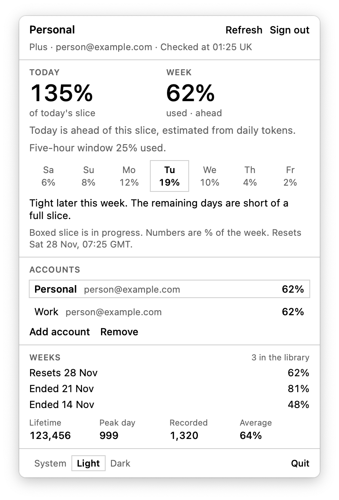
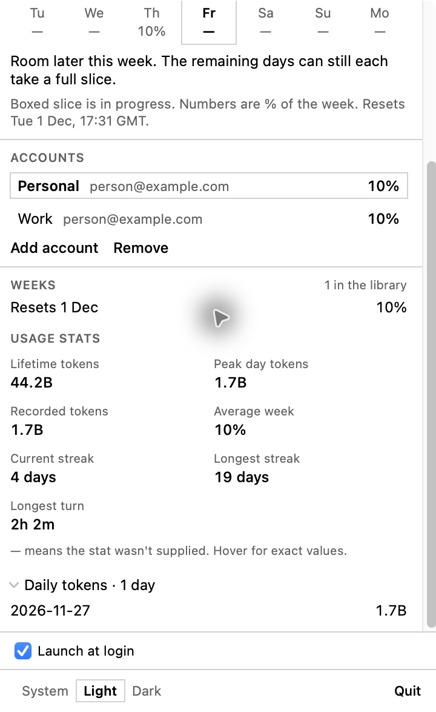
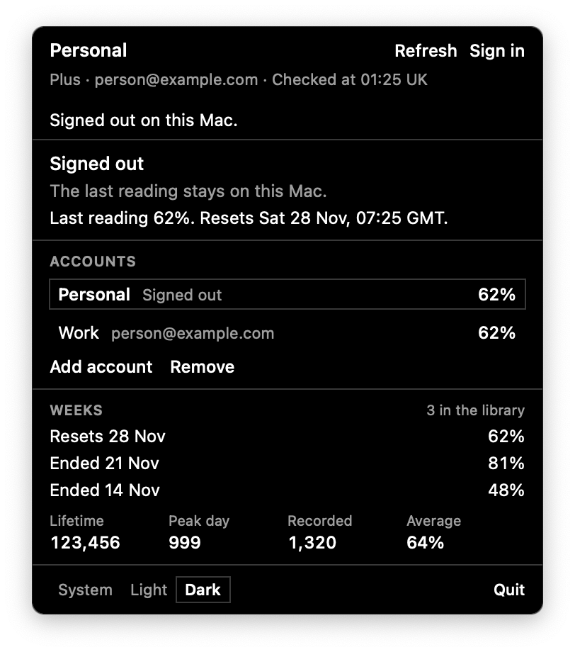
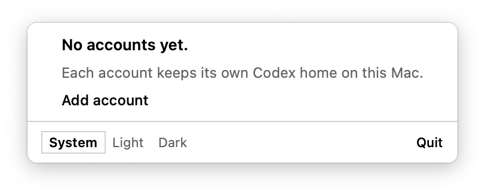

<p align="center">
  
</p>

<h1 align="center">Pace the week, one slice a day.</h1>

<p align="center">
  Codex Quota is a Mac menu-bar panel for a Codex weekly allowance.<br>
  It tells you how today is going, not only how the week looks.
</p>

<p align="center">
  <a href="#get-started"><strong>Get started</strong></a>
  &nbsp;·&nbsp;
  <a href="#what-you-can-do">What you can do</a>
  &nbsp;·&nbsp;
  <a href="docs/quota-app-plan.md">How the pacing works</a>
  &nbsp;·&nbsp;
  <a href="docs/GETTING-STARTED.md">Build and run</a>
</p>

<p align="center">
  macOS 14 or later &nbsp;·&nbsp; menu bar, no Dock icon &nbsp;·&nbsp; built from source &nbsp;·&nbsp; no license file yet
</p>

A weekly allowance is one number. The day you are in is another. You can be comfortable for the week and already past today's share, or the other way around. Codex Quota splits the week into seven equal slices, in Europe/London, and puts today's slice in the menu bar.

## The panel

Open the app to show the panel, or click its figure in the menu bar. Opening the app again brings the panel back. There is no desktop window and no Dock icon while the app is running.

<picture>
  <source media="(prefers-color-scheme: dark)" srcset="docs/assets/screenshots/panel-dark.png">
  
</picture>

The large pair is the point. **Today** is this slice, as a percent of a fair share of the week; a dash means it cannot be measured yet. **Week** is how much of the allowance is already used. The row underneath is each slice as a percent of the week, and the box is the slice you are in now.

The panels on this page were captured from the real app against a local stand-in. The address `person@example.com` and the figures are sample readings, not a live Codex account.

## What you can do

**See the day and the week at once.**
The menu-bar title is the glance: `49%`, `154% over`, or `62% wk` when today is still unknown. With one account it stays that compact; with more than one it adds a short selected-account name, such as `Work · 49%`. The full account name and reading remain available in the tooltip and to VoiceOver. The panel is where the sentence lives: ahead of the slice, inside it, or still filling in.

**Keep more than one account.**
Personal and work each get a Codex home on this Mac. The list shows the week percent. Add one, and the panel reads it. Sign-in opens in the browser. The library stores readings, not tokens.

**Look back without losing the plot.**
Finished weeks stay in the list. Usage stats use compact K/M/B/T figures, with exact counts on hover. Lifetime tokens, peak day, longest turn, and current and longest streaks come from Codex. Recorded tokens, the completed-week average, and the current open week come from this Mac's library. When there is no completed week yet, the current partial week is clearly labelled as the fallback. Expand Daily tokens to see every day returned in the latest reading; unavailable stats show a dash.

<picture>
  <source media="(prefers-color-scheme: dark)" srcset="docs/assets/screenshots/stats-dark.png">
  
</picture>

**Leave a reading behind when you sign out.**
The last percent and its reset stay on the machine. The open week is not called "last week."

<p align="center">
  
</p>

**Match the desk.**
System, Light, and Dark live on the footer, next to Quit, and the choice is kept. Light is white with black text. Dark is black with white text. Hairline rules, no coloured cards.

**Start with your Mac.**
Install the app in Applications, then enable **Launch at login** in the panel. It starts quietly in the menu bar after you sign in to macOS. The checkbox reflects the system setting, and the panel links to Login Items if approval is needed.

Before any account exists, the panel invites you to add one. Enter a name and press Return, then sign in with ChatGPT.

<p align="center">
  
</p>

## A week, in plain language

The allowance is the whole week. Each of the seven slices is an equal share of it. Today is measured against the slice you are in, not against the whole week.

If the provider did not include a reset time, today's slice stays hidden and the menu shows the week. A reading older than 15 minutes says so, and the last good numbers stay.

<details>
<summary>Where the numbers come from</summary>

Codex Quota talks to the Codex app server on this Mac, over stdio. It asks `account/read`, `account/rateLimits/read`, and `account/usage/read`. Sign-in uses `account/login/start`. Tokens stay in that account's Codex home.

Days are equal slices of the weekly window, named in Europe/London. The full rules, including the worked example, are in [the pacing plan](docs/quota-app-plan.md).

</details>

## Get started

Build and install from source on a Mac with **macOS 14+**, **Swift 6**, and the **Codex CLI** already installed:

```sh
git clone https://github.com/lcherone/CodexQuota.git
cd CodexQuota
./scripts/install-app.sh
open "$HOME/Applications/CodexQuota.app"
```

The installer uses `~/Applications`, needs no administrator access, and keeps account data when updating. Quit the app before running it again. Enable **Launch at login** in the installed app to start automatically. Opening it normally shows the panel; Escape or clicking elsewhere dismisses it, and Quit is on the footer.

To make the bundle and ZIP without installing:

```sh
./scripts/build-app.sh
open build/CodexQuota.app
```

This creates `build/CodexQuota.app` and `build/CodexQuota.zip` for the Mac architecture you build on. You can also move the app into `/Applications` or `~/Applications` in Finder. The bundle includes the utility, icon, and metadata; the Codex CLI remains a separate prerequisite.

The bundle is signed ad hoc for local use, not Developer ID signed or notarized. There is no published binary release yet. More install, update, startup, and removal details are in [Build and run](docs/GETTING-STARTED.md).

For development without a bundle:

```sh
swift run CodexQuota
```

Checks run against a local mock. They do not call OpenAI and they do not read a Codex home that already has a login.

```sh
swift run CodexQuotaChecks
```

More detail is in [Build and run](docs/GETTING-STARTED.md).

## Status

This is an early Mac app, version 0.1.0, for macOS 14 and later. It is a menu-bar utility, not a document you leave on the desktop.

The repository does not include a license file. Do not assume a license until one is added.

Issues and ideas belong on the [issue tracker](https://github.com/lcherone/CodexQuota/issues).

<p align="center">
  
</p>
