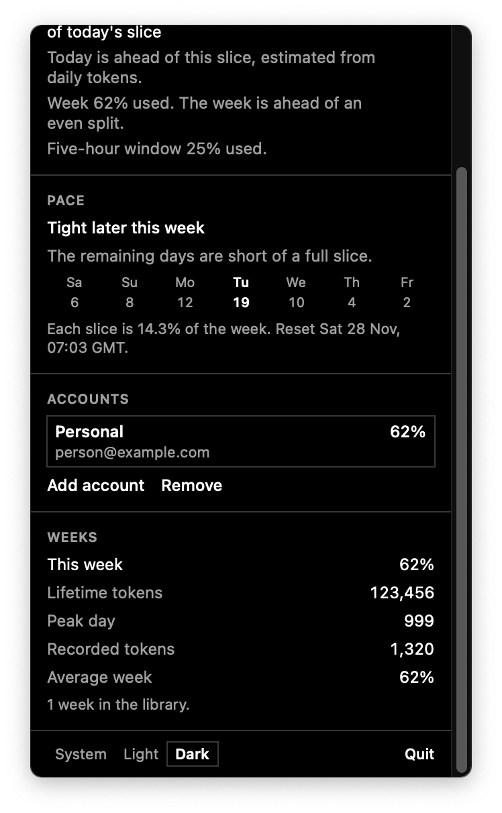
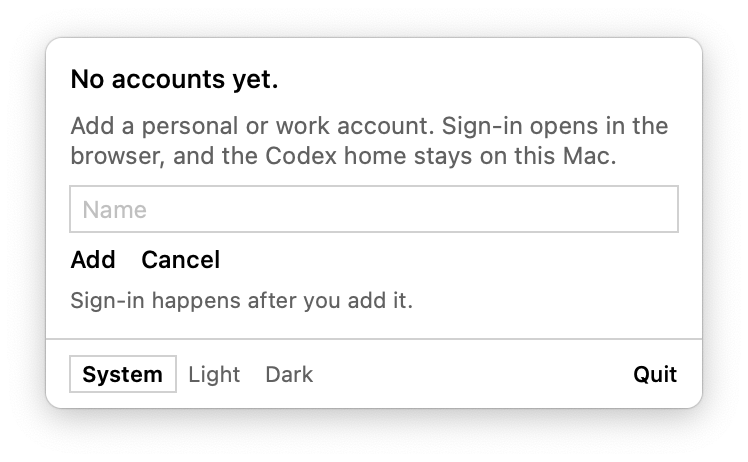
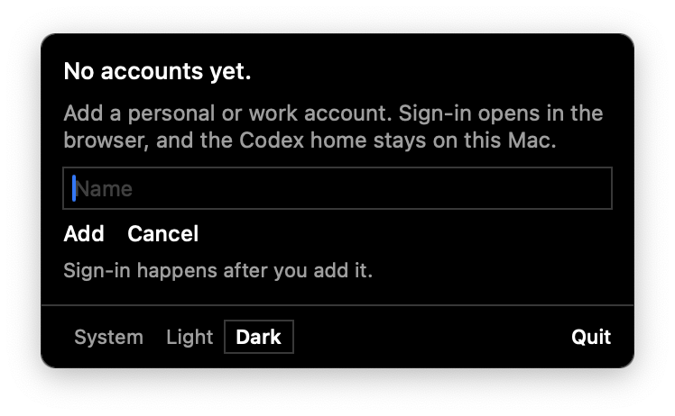
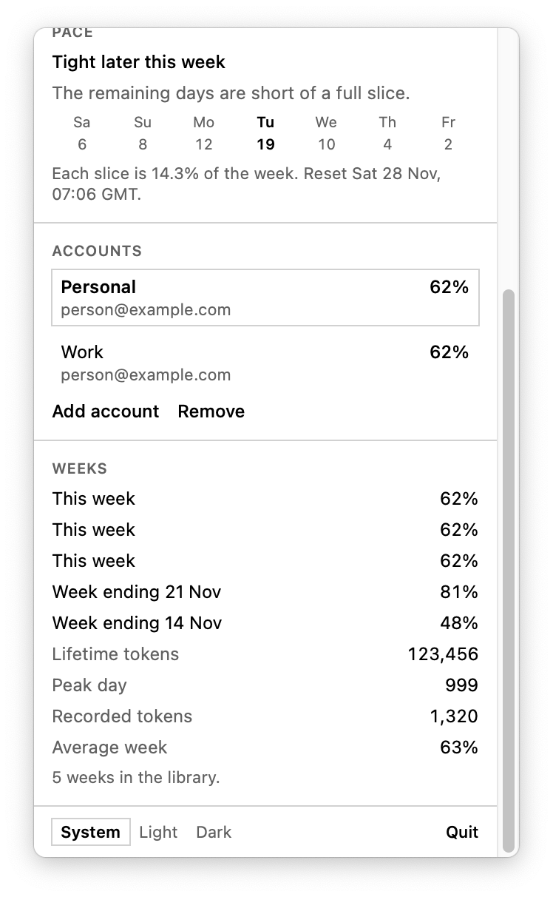
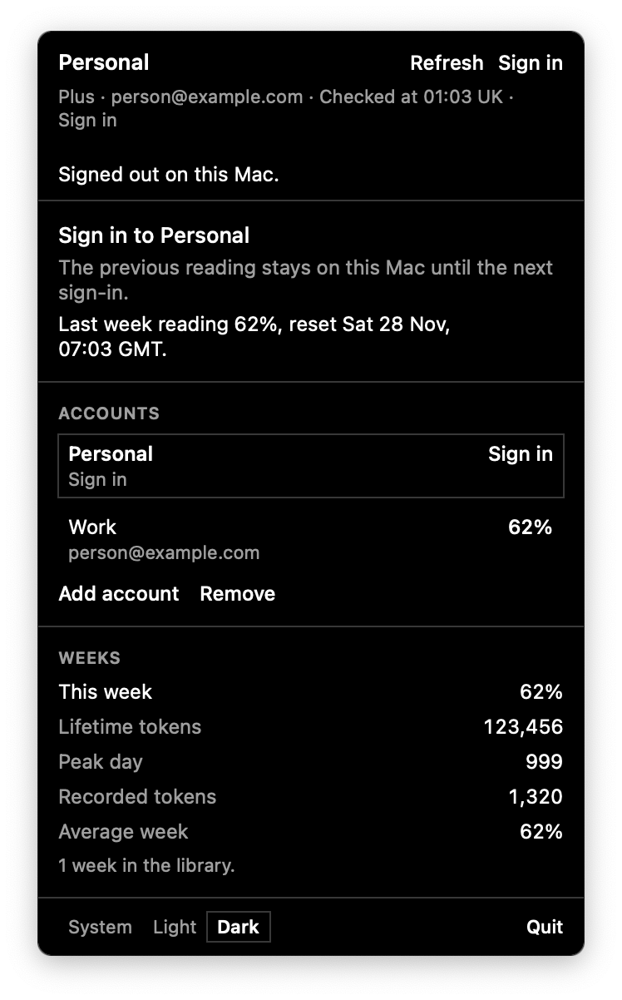
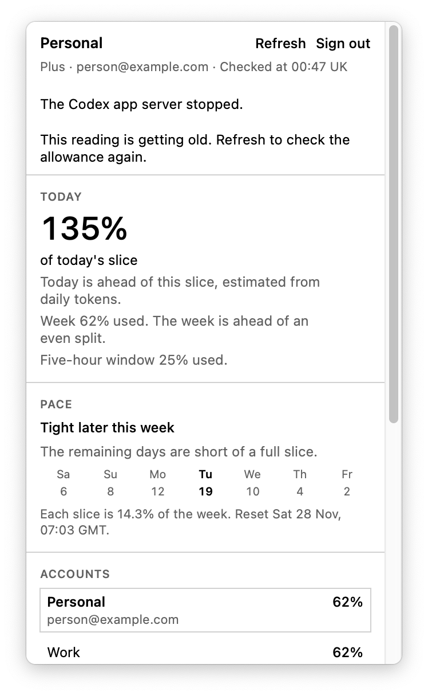

# CodexQuota

A menu-bar panel for pacing a Codex weekly allowance on Mac. It shows more than one account, each with its own Codex home. The status item shows today's slice as a percent of the week. The panel shows that figure, whether the day and week are ahead of an even pace, the accounts, and week history. System, Light, and Dark sit on the panel footer. The choice is kept in `store.json`.

Sign-in opens in the browser. Tokens stay in that account's Codex home. The library under `~/Library/Application Support/CodexQuota` stores readings, not tokens.

## Panel

Light and dark are the same layout. The status item stays in the menu bar. Click it to show or hide this panel.


The lower part of a full reading, including week stats and the theme control:



Empty, before an account is added:





Week history, following the system appearance:



Signed out, with the last reading kept:



A stopped server, with a reading old enough to mark stale:



## Build

From `~/CodexQuota`:

```sh
swift build --product CodexQuota
```

The binary is `.build/debug/CodexQuota`.

Checks talk only to the local mock:

```sh
swift run CodexQuotaChecks
```

## Run

```sh
swift run CodexQuota
```

Or launch the binary from the build above. Quit from the bottom of the panel.

To bundle a `.app` (this also sets `LSUIElement`):

```sh
./scripts/build-app.sh
open build/CodexQuota.app
```
