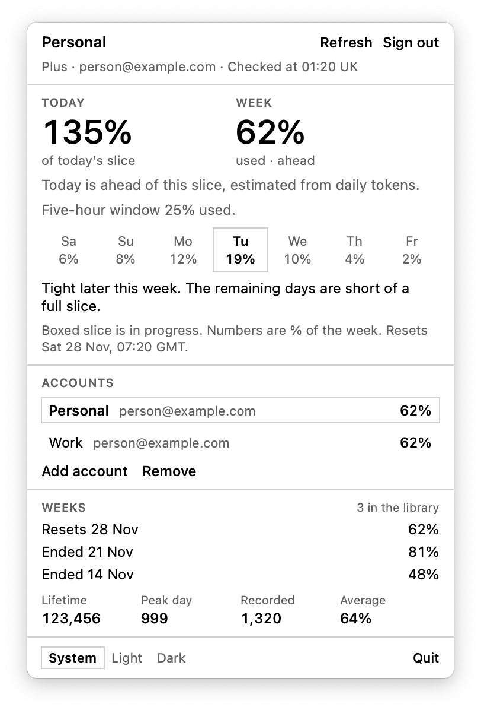
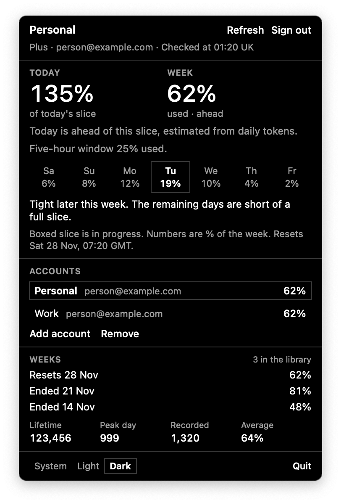

# CodexQuota

A menu-bar panel for pacing a Codex weekly allowance on Mac. It shows more than one account, each with its own Codex home. The status item shows today's slice as a percent of the week. The panel shows that figure, whether the day and week are ahead of an even pace, the accounts, and week history. System, Light, and Dark sit on the panel footer. The choice is kept in `store.json`.

Sign-in opens in the browser. Tokens stay in that account's Codex home. The library under `~/Library/Application Support/CodexQuota` stores readings, not tokens.

## Panel

Today and the week sit side by side. The outlined slice is the one in progress, and the numbers under the days are percent of the week. Theme and Quit stay on the footer.





## Build

From `~/CodexQuota`:

```sh
swift build --product CodexQuota
```

The binary is `.build/debug/CodexQuota`.

Checks talk only to the local mock:

```sh
swift run CodexQuotaChecks
```

## Run

```sh
swift run CodexQuota
```

Or launch the binary from the build above. Quit from the bottom of the panel.

To bundle a `.app` (this also sets `LSUIElement`):

```sh
./scripts/build-app.sh
open build/CodexQuota.app
```
