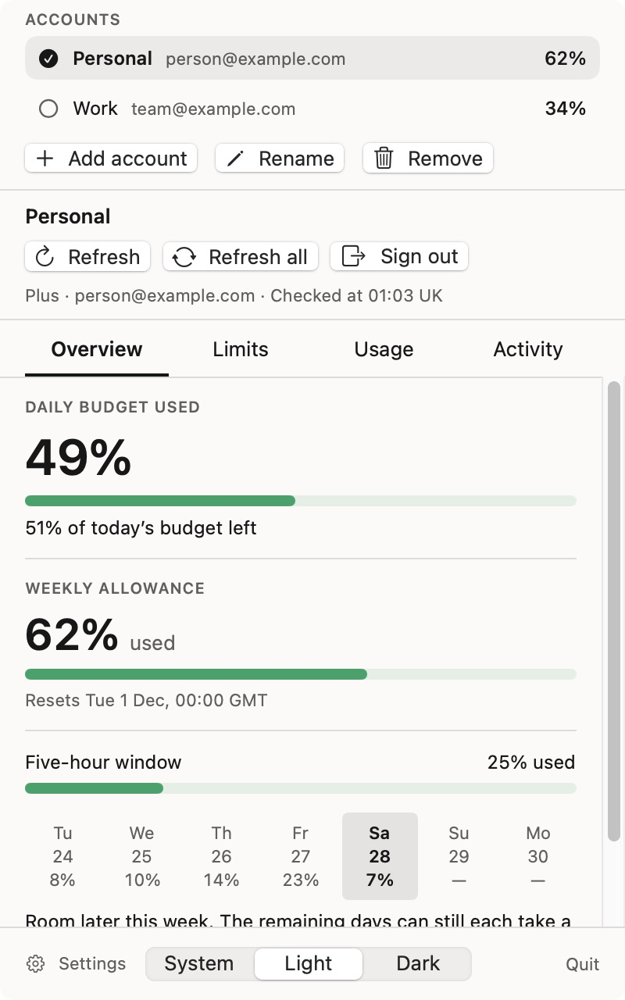
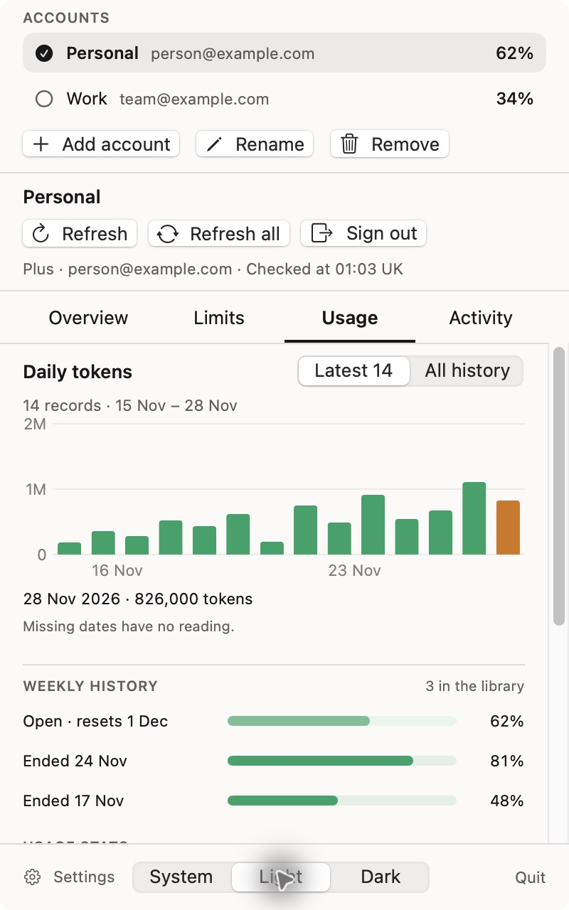
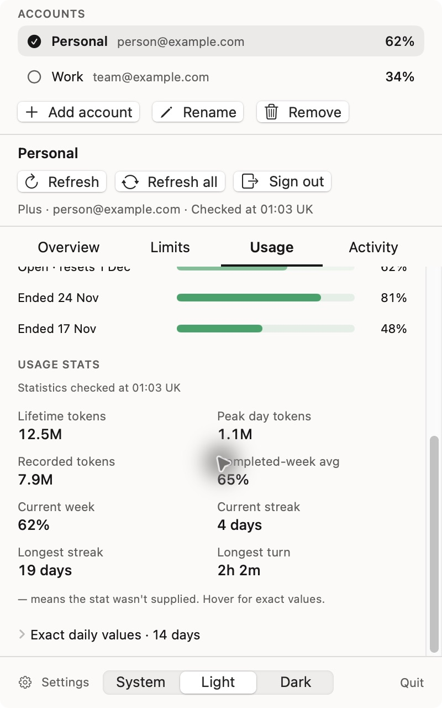
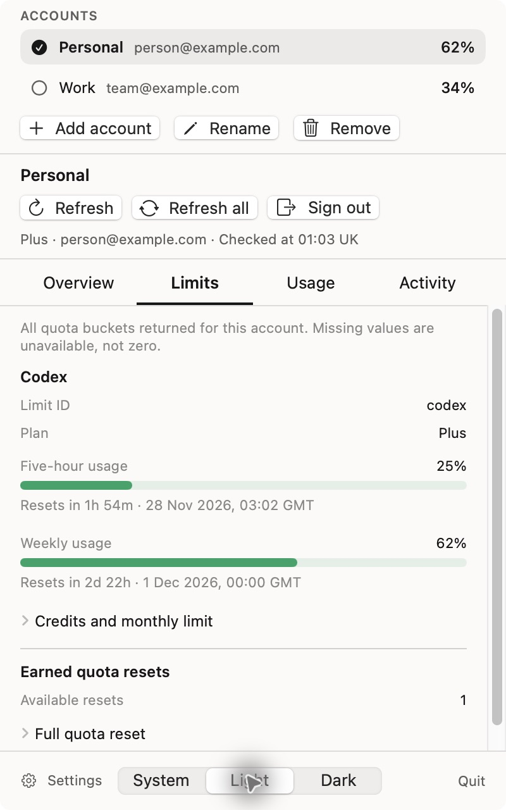
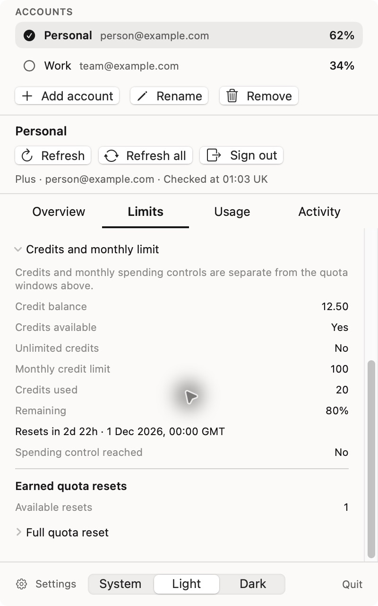
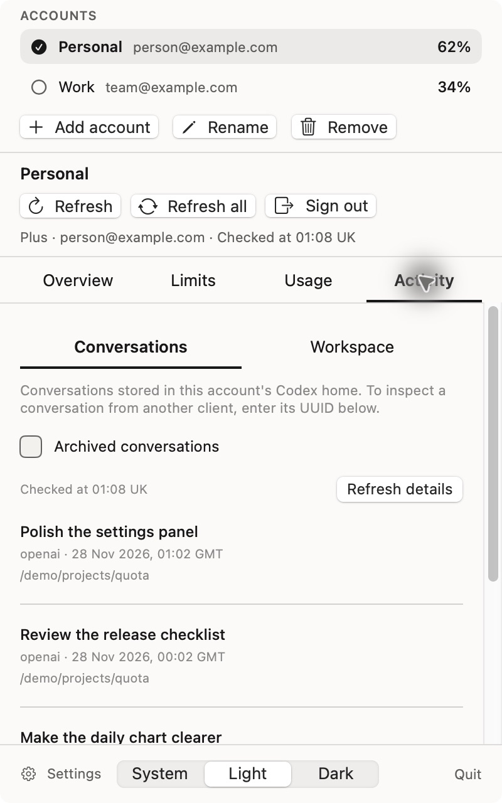
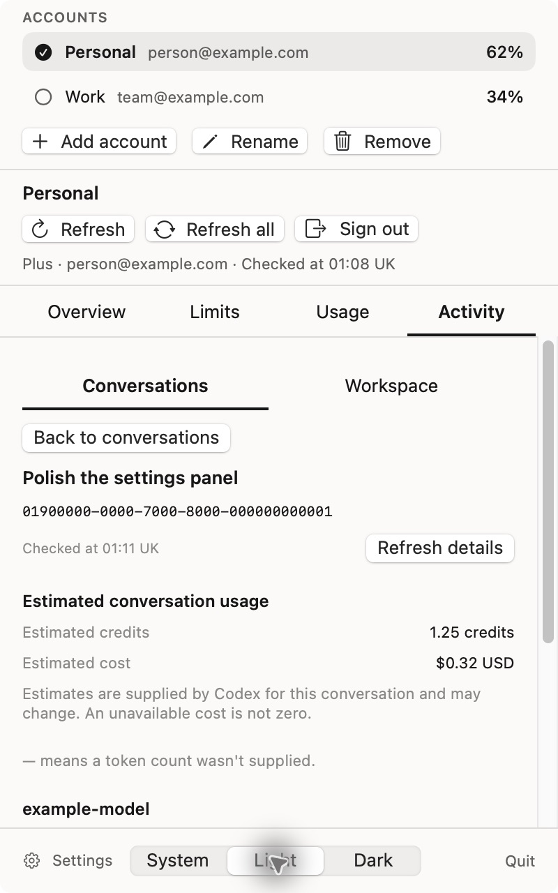
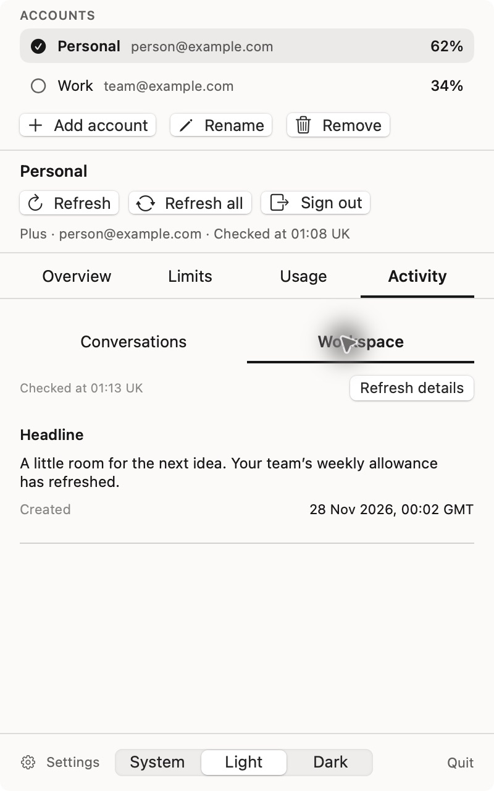
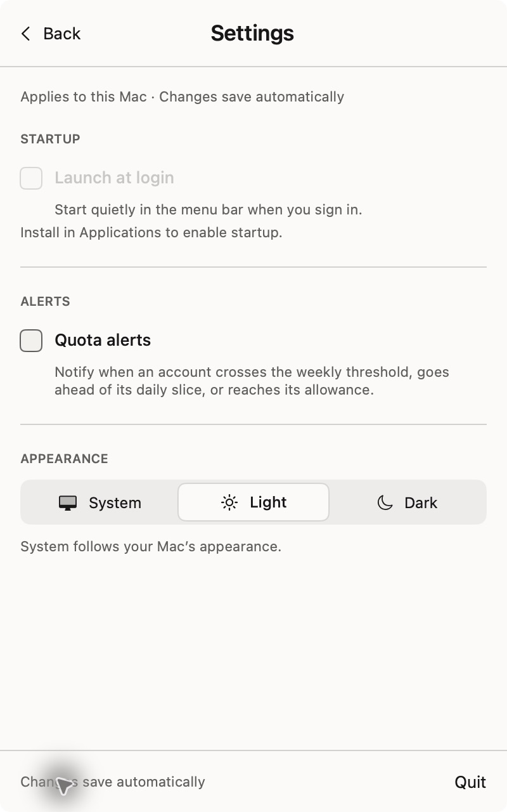

# A closer look at Codex Quota

[← Back to the project](../README.md)

Codex Quota is a native Mac menu-bar panel for understanding today’s usage alongside a weekly allowance. Click its menu-bar figure to open it, click elsewhere to dismiss it, or open the app again to bring the panel back. It has no Dock icon and no persistent desktop window.

The screenshots here are genuine captures of the current app using an isolated, offline sample backend. Addresses, conversation names, costs, credits and usage are examples. Provider-specific fields may be absent on a real account.

## Overview: a daily share of the week

<picture>
  <source media="(prefers-color-scheme: dark)" srcset="assets/screenshots/overview-dark.png">
  
</picture>

The week is split into seven equal quota-day slices. **Daily budget used** measures consumption against the full share for the current slice. **Weekly allowance** measures consumption against the whole allowance. The daily bar turns amber above 100%; a dash means the daily amount cannot yet be measured.

A **≥** figure is a lower bound from a partial reading. An estimate based on daily token totals is labelled as estimated. Neither should be mistaken for an exact measurement. Pacing guidance also considers how far through the current slice you are, so “ahead of the slice” and “over the full daily budget” are different statements.

The boxed slice is in progress. Its figures are percentages of the weekly allowance, not of a daily budget. Slice labels use Europe/London; a quota day follows the provider’s reset window rather than necessarily starting at local midnight.

When supplied, a separate short-term window appears below the weekly budget. Without a weekly reset time, the app cannot construct the daily slices and falls back to the weekly reading in the menu bar.

The menu-bar title can show `49%`, `154% over`, or a weekly fallback such as `62% wk`. With multiple accounts, it includes a short selected-account name, such as `Work · 49%`. Full details remain in the tooltip and accessibility label.

## Accounts: separate homes, one panel

Each account has an app-created Codex home on this Mac. The visible account rows show the name, sign-in identity and weekly usage. Selecting an account updates the current tab’s content.

- **Add account** accepts a name; sign-in opens in the browser when requested.
- **Rename** changes the local label. Empty or whitespace-only names cannot be saved.
- **Refresh** checks the selected account; **Refresh all** checks the account list and reports progress or failures.
- **Sign out** retains the last reading on this Mac.
- **Remove** requires confirmation because it deletes the app-created Codex home and that account’s recorded history.

Return submits valid account forms; Escape cancels a form or confirmation before dismissing the panel. The account rows and refresh controls remain visible while content scrolls.

## Usage: history without the spreadsheet

<picture>
  <source media="(prefers-color-scheme: dark)" srcset="assets/screenshots/usage-dark.png">
  
</picture>

The daily chart uses real dates and the supplied token values. **Latest 14** selects the latest 14 records, which need not be consecutive dates. **All history** uses every daily record in the reading. Missing dates are gaps, not zero readings. Ranges crossing a year boundary include years. Hovering shows an exact date and token count; the readout defaults to the newest record.

Weekly history labels open windows separately from completed ones. The current partial window is not included in the completed-week average. The newest six windows are shown first; expand older history when available.

<picture>
  <source media="(prefers-color-scheme: dark)" srcset="assets/screenshots/statistics-dark.png">
  
</picture>

| Statistic | Source |
| --- | --- |
| Lifetime tokens | Codex’s supplied lifetime total. |
| Peak day tokens | Codex’s supplied peak-day total. |
| Recorded tokens | Sum of daily totals retained in this Mac’s library. |
| Completed-week average | Average allowance used across completed quota windows in the local library. If none is complete, the current partial week is explicitly labelled as a fallback. |
| Current week | Usage in the current open window. |
| Current streak | Supplied by Codex. |
| Longest streak | Supplied by Codex. |
| Longest turn | Supplied by Codex and displayed as a duration. |

Numbers use compact K/M/B/T notation. Hover over statistics for exact counts and context. **—** means the statistic was not supplied.

Expand **Exact daily values** to see the newest 14 daily records. **Show 14 more days** reveals older records; **Show fewer days** returns to the initial set. Statistics have their own checked time. If an optional statistics request fails, the app labels the retained result rather than silently treating it as fresh.

## Limits: keep the windows and credits distinct

<picture>
  <source media="(prefers-color-scheme: dark)" srcset="assets/screenshots/limits-dark.png">
  
</picture>

Limits shows every returned quota bucket, its identifier and plan, plus the supplied windows and their reset countdowns. Unknown durations keep their reported window label; missing values say **Not supplied**.

Within each bucket, **Credits and monthly limit** can show the credit balance, availability, unlimited-credit status, monthly credit limit, amount used, remaining percentage and spending-control status. These are separate from the quota-window percentages.

See the expanded credit details

Earned resets show the available count and any returned descriptions, status, grant dates, expiry dates and identifiers. The app displays them for reference; it has no reset-redemption action. If the service returns a count without all the descriptions, that distinction is stated.

## Activity: follow a conversation into its usage

<picture>
  <source media="(prefers-color-scheme: dark)" srcset="assets/screenshots/activity-dark.png">
  
</picture>

**Conversations** lists active or archived threads in the selected account’s isolated Codex home. It supports pagination when more results are available. Other clients’ conversations are not automatically imported.

Select a conversation, or enter a valid conversation UUID, to request estimates for the active account. An invalid UUID cannot be submitted. A valid UUID does not guarantee that the backend will make the conversation’s usage available.

<picture>
  <source media="(prefers-color-scheme: dark)" srcset="assets/screenshots/conversation-dark.png">
  
</picture>

When supplied, details include estimated credits, estimated USD cost, native dollar usage, and model/reasoning-effort/speed groups with new input, cached input, total input, output and total tokens. The backend supplies these estimates and they may change. An unavailable cost is not zero.

**Workspace** shows announcements when enabled for the account, including message text and supplied created/archive times. Disabled and empty states are explicit.

See a sample Workspace announcement

Activity requests load on demand and have their own checked time, refresh and retry actions. Failures retain the previous result with an error notice. Signing out or removing an account clears its in-memory activity results. Activity content is not written into the usage-history library; quota details are retained with usage samples.

## Settings

<picture>
  <source media="(prefers-color-scheme: dark)" srcset="assets/screenshots/settings-dark.png">
  
</picture>

Open Settings from the footer. It replaces the quota view inside the same panel; **Back** or **Escape** restores the previous account, tab and scroll position. Changes save automatically.

| Control | Behaviour |
| --- | --- |
| **Launch at login** | The styled checkbox reflects the actual macOS login-item state. Install in `/Applications` or `~/Applications` to enable registration. **Open Login Items** appears when approval is required. The temporary demo bundle pictured above is outside Applications, so its startup checkbox is correctly disabled. |
| **Quota alerts** | Applies to all accounts and requires macOS notification permission. Alerts cover weekly-threshold crossings, going ahead of the current daily slice, and reaching an allowance. |
| **Weekly threshold** | Appears while alerts are enabled. Minus/plus changes it in five-percentage-point steps within 1–100%; the default is 80%. |
| **Appearance** | System follows macOS; Light uses warm white; Dark uses charcoal. The choice persists and is also available in the main footer. |

Denied notification permission produces an **Open Notification Settings** action. Unavailable notifications are explained. Quitting ends the current session without disabling a registered login item.

## Reading age, storage and limitations

A reading older than 15 minutes is labelled as stale. A failed refresh retains the last good result. Optional fields remain unavailable when omitted, not invented or treated as zero.

Readings, names, appearance and alert preferences live in a local library. Sign-in tokens stay in the account’s app-created Codex home. Provider requests go through the installed Codex CLI. See [storage and installation](GETTING-STARTED.md#what-stays-on-this-mac) and the [pacing rules](quota-app-plan.md).

The app requires macOS 14+, Swift 6 to build, and a separately installed Codex CLI. It is an early, source-built app with no published binary release or license file. It is not a general-purpose Codex client, a conversation importer or a forecast of future usage.
